# Awesome Enterprise Endpoint Protection 🛡️

  

  
  
  
  
  

---

> 🚀 **Awesome Enterprise Endpoint Protection** is a comprehensive, curated directory and technical guide to enterprise-grade **Endpoint Detection and Response (EDR)**, **Extended Detection and Response (XDR)**, **Endpoint Protection Platforms (EPP)**, and **Host-Based Intrusion Detection Systems (HIDS)**. This repository tracks both leading commercial cloud SaaS suites and production-ready open-source security agents for cross-platform threat hunting, ransomware rollback, and zero-trust cybersecurity.  
> 🌟 **Star this repository** if you find it valuable for your SecOps, SOC, and IT engineering roadmaps! 🌟

---

## 📋 Table of Contents 📑

- [📈 Sector Overview & Market Dynamics](#-sector-overview--market-dynamics)
- [🟦 SaaS & Commercial Enterprise Platforms](#-saas--commercial-enterprise-platforms)
  - [Commercial Vendor Feature Deep Dive](#-commercial-vendor-feature-deep-dive)
- [🟩 Open-Source Software](#-open-source-software)
  - [Open-Source Solutions Deep Dive](#-open-source-solutions-deep-dive)
- [📊 Comparison at a Glance](#-comparison-at-a-glance)
- [🔍 Key Evaluation Criteria for SecOps Teams](#-key-evaluation-criteria-for-secops-teams)
- [🤝 Contributing](#-contributing)
- [📄 License](#-license)

---

## 📈 Sector Overview & Market Dynamics 🌐

The global **Enterprise Endpoint Security and EDR/XDR market** is estimated at **$14.8 billion in 2024–2025** and is projected to expand rapidly beyond **$30 billion by 2030**, exhibiting a compound annual growth rate (CAGR) exceeding **14%**. The acceleration is catalyzed by widespread enterprise adoption of hybrid/remote workforces, escalating ransomware sophistication, nation-state cyber warfare, and mandatory compliance standards requiring continuous endpoint behavioral telemetry.

The market structure is **moderately concentrated with oligopolistic tendencies** among top-tier titans: **Microsoft (Defender for Endpoint)**, **CrowdStrike (Falcon)**, **Palo Alto Networks (Cortex XDR)**, and **SentinelOne (Singularity)** capture a commanding majority of enterprise Fortune 500 seat deployments and cloud telemetry volume. Strong platform ecosystems, MDR services, cross-domain XDR integration, and vendor consolidation create formidable flywheels and high switching costs. Concurrently, a vital and expanding open-source ecosystem (led by **Wazuh**, **osquery**, **Fleet**, and **Velociraptor**) maintains strong traction across Linux cloud workloads, air-gapped defense enclaves, and engineering-led security teams requiring unconstrained data ownership and zero per-seat licensing friction.

---

## 🟦 SaaS & Commercial Enterprise Platforms 💼

The following table presents top commercial enterprise endpoint security platforms, ranked in **descending order by company scale** (market capitalization or enterprise valuation), with verified entry pricing and precise free tier/trial boundaries.

| Platform / Vendor | Company Scale (Valuation / Market Cap) | Starting Tier Pricing | Free Tier & Free Trial Limits | Key Deployment & Strengths |
| :--- | :--- | :--- | :--- | :--- |
| **[Microsoft Defender for Endpoint](https://www.microsoft.com/en-us/security/business/endpoint-security/microsoft-defender-endpoint)** | **~$3.10 Trillion** (Microsoft Corp.) | **$3.00 / user / month** (Plan 1 standalone) / **$5.20 / user / month** (Plan 2 standalone) | **90-Day Free Trial** up to 250 evaluation licenses with full Plan 2 threat analytics and Automated Investigation & Remediation (AIR) capabilities | Native integration with Microsoft 365 E5/A5/G5, Entra ID, Intune, Defender XDR, and Sentinel SIEM; analyst-in-the-loop AIR. |
| **[Broadcom Symantec Endpoint Security](https://www.broadcom.com/products/cyber-security/endpoint)** | **~$820 Billion** (Broadcom Inc.) | **$39.08 / endpoint / year** (~$3.26/device/mo through enterprise authorized resellers) | **30-Day Free Evaluation Trial** with proof-of-concept tenant access and full cloud console policy enforcement | Long-standing enterprise footprint with behavioral attack surface reduction, AD security, and deep Broadcom enterprise contract bundling. |
| **[Palo Alto Cortex XDR](https://www.paloaltonetworks.com/cortex/cortex-xdr)** | **~$110 Billion** (Palo Alto Networks) | **$65.00 / endpoint / year** (~$5.42/endpoint/month via authorized cloud marketplace listings) | **30-Day Free Trial** with full access to cloud management tenant, behavioral analytics, and sample incident triage datasets | Integrated XDR correlation across endpoints, NGFW network traffic, and Prisma Cloud; agentic AI SOC investigation playbooks. |
| **[CrowdStrike Falcon Enterprise](https://www.crowdstrike.com/)** | **~$80 Billion** (CrowdStrike Holdings) | **$59.99 / device / year** (~$5.00/device/mo for Falcon Go; Falcon Pro starts at $99.99/device/year) | **15-Day Free Trial** for up to 100 endpoints with Falcon Prevent (NGAV), cloud-native console telemetry, and threat intelligence feeds | AI-native single lightweight agent, elite nation-state threat adversary intelligence (OverWatch/Complete), and first-class macOS/Linux fleet parity. |
| **[Trend Micro Vision One](https://www.trendmicro.com/en_us/business/products/one-platform.html)** | **~$8.5 Billion** (Trend Micro Inc.) | **$53.50 / user / year** (~$4.46/user/month for Endpoint Security essential tier) | **30-Day Free Trial** with unlimited telemetry credits during evaluation across endpoint, email, and cloud workloads | Broadest telemetry correlation spanning endpoints, servers, OT/IoT environments, and hybrid email infrastructure with integrated TrendAI. |
| **[SentinelOne Singularity Complete](https://www.sentinelone.com/)** | **~$6.5 Billion** (SentinelOne Inc.) | **$45.00 / agent / year** (~$3.75/agent/mo for Singularity Core; Complete starts at ~$75/agent/yr) | **30-Day Free Trial** (Singularity Cloud/Core evaluation) with full autonomous ransomware rollback, Storyline visualization, and API access | True on-device autonomous response, 1-Click cryptographic ransomware rollback without network connectivity, and Storyline threat graph. |
| **[Tanium Core Platform](https://www.tanium.com/)** | **~$9.0 Billion** (Private Valuation) | **$8.00 / endpoint / month** (Tanium Cloud core visibility tier) | **14-Day Free Hands-On Lab Trial** with full interactive cloud console and live endpoint querying over simulated workloads | Linear chain-architecture allowing sub-second real-time queries and remediation across 100,000+ distributed endpoints without WAN saturation. |
| **[Carbon Black Cloud](https://www.carbonblack.com/)** | **~$4.0 Billion** (Enterprise Valuation; Acquired by Broadcom) | **$52.99 / endpoint / year** (~$4.42/endpoint/month for Endpoint Standard tier) | **30-Day Free Proof-of-Concept Trial** with complete cloud console access, tamper protection, and continuous event stream recording | Deep VMware vSphere hypervisor integration, continuous unfiltered raw telemetry recording for retroactive threat hunting and compliance. |
| **[Sophos Intercept X](https://www.sophos.com/en-us/products/endpoint-antivirus)** | **~$3.9 Billion** (Enterprise Valuation; Thoma Bravo portfolio) | **$28.00 / user / year** (~$2.33/user/month for Intercept X Advanced base tier) | **30-Day Free Trial** with unlimited endpoints and complete features including CryptoGuard anti-ransomware and deep learning exploit prevention | Industry-leading CryptoGuard ransomware mitigation, deep neural network detection engines, and tightly integrated Sophos Managed Detection and Response (MDR). |
| **[Trellix Endpoint Security](https://www.trellix.com/)** | **~$2.5 Billion** (Enterprise Valuation; Symphony Technology Group) | **$42.00 / endpoint / year** (~$3.50/endpoint/month for Trellix Endpoint Protection suite) | **30-Day Free Evaluation Trial** with access to Trellix ePolicy Orchestrator (ePO) cloud management and multi-vector correlation engines | Heritage combining McAfee Enterprise scale and FireEye/Mandiant threat intelligence; comprehensive multi-vector XDR correlation across email and network. |

---

### 🔍 Commercial Vendor Feature Deep Dive

#### 🦅 CrowdStrike Falcon Enterprise
- **Core Architecture:** AI-native cloud architecture powered by a single lightweight kernel agent (<50MB RAM footprint).
- **Key Capabilities:** Unmatched threat intelligence attribution, real-time indicator-of-attack (IOA) engines, automated containment, and vendor-staffed 24/7 Falcon Complete MDR.
- **Best Suited For:** Heterogeneous OS enterprises (Windows, macOS, Linux) prioritizing top-echelon detection fidelity and threat actor tracking.

#### 🪟 Microsoft Defender for Endpoint
- **Core Architecture:** Built-in OS-level sensor framework on Windows with zero third-party software installation required, supplemented by macOS and Linux daemon agents.
- **Key Capabilities:** Deep synergy with Microsoft 365 Defender, automated investigation and remediation (AIR), device risk-based conditional access via Intune, and unified SIEM integration with Microsoft Sentinel.
- **Best Suited For:** Organizations heavily invested in Microsoft 365 E5 estates requiring unified licensing and centralized governance.

#### ⚡ SentinelOne Singularity Complete
- **Core Architecture:** Distributed on-agent machine learning behavioral engine that evaluates system activity locally without requiring constant cloud connectivity.
- **Key Capabilities:** Patented 1-Click ransomware rollback leveraging Windows VSS and proprietary snapshot recovery, automated Storyline graph correlation, and Star-query threat hunting.
- **Best Suited For:** Security teams demanding autonomous dwell-time reduction and instant post-ransomware restoration with minimal analyst overhead.

#### 🛡️ Palo Alto Cortex XDR
- **Core Architecture:** Unified data engine correlating native telemetry across network firewalls, Prisma cloud workloads, identity, and endpoint agents.
- **Key Capabilities:** Cross-data-source root-cause analysis, machine learning anomaly detection, incident scoring, and automated containment across network and endpoint boundaries.
- **Best Suited For:** Palo Alto Networks infrastructure customers looking to eliminate security silos into an integrated SOC platform.

#### 🌐 Trend Micro Vision One
- **Core Architecture:** Comprehensive telemetry collector correlating endpoint events with corporate email, cloud virtual machines, and industrial OT/IoT networks.
- **Key Capabilities:** Advanced risk scoring, virtual patching against zero-day exploits, integrated managed XDR services, and proactive attack surface risk management (ASRM).
- **Best Suited For:** Multi-cloud enterprises and industrial manufacturers needing visibility across conventional IT, OT machinery, and cloud workloads.

#### 🔒 Sophos Intercept X
- **Core Architecture:** Multi-layered defense engine combining deep learning neural networks, signatureless exploit prevention, and dedicated anti-ransomware monitors.
- **Key Capabilities:** CryptoGuard anti-ransomware driver that inspects file encryption attempts in real time, root-cause visualization, and seamless escalation to Sophos MDR.
- **Best Suited For:** Mid-market enterprises and lean security teams requiring enterprise-grade ransomware resilience without enterprise SOC overhead.

#### 🏛️ Trellix Endpoint Security
- **Core Architecture:** Hybrid endpoint defense platform orchestrating McAfee's enterprise agent telemetry and FireEye's dynamic threat intelligence.
- **Key Capabilities:** Centralized orchestration via Trellix ePolicy Orchestrator (ePO), proactive attack simulation, dynamic application containment, and adaptive threat protection.
- **Best Suited For:** Large regulated enterprises and government entities with existing ePO automation frameworks.

#### 💾 Carbon Black Cloud
- **Core Architecture:** Event-driven streaming analytics architecture continuously recording process hierarchies, network sockets, and file system mutations.
- **Key Capabilities:** Retroactive threat hunting against historical unfiltered events, deep kernel-level visibility, and native integration with VMware vSphere virtual environments.
- **Best Suited For:** Dedicated threat hunters and VMware-heavy data centers requiring immutable audit histories for forensics.

#### ⏱️ Tanium Core Platform
- **Core Architecture:** Proprietary linear-chain peer-to-peer architecture allowing bi-directional querying across enterprise endpoints without overloading WAN circuits.
- **Key Capabilities:** Real-time software asset discovery, patch hygiene compliance, unmanaged asset interrogation, and live threat hunting query responses in under 15 seconds.
- **Best Suited For:** Mega-scale corporate and government environments (10,000 to 500,000+ endpoints) needing combined IT hygiene and live telemetry.

#### 🏢 Broadcom Symantec Endpoint Security
- **Core Architecture:** Multi-tier client protection suite incorporating behavioral reputation (Insight), machine learning heuristics (SONAR), and cloud-delivered policy management.
- **Key Capabilities:** Active Directory credential theft defense, network integrity protection, breach assessment, and deep enterprise contract bundling.
- **Best Suited For:** Traditional enterprise accounts and financial institutions with established Symantec administrative infrastructure.

---

## 🟩 Open-Source Software 🔓

The following community-driven, open-source endpoint security, EDR, HIDS, and osquery instrumentation frameworks are ranked in **descending order by GitHub stargazers**. Each project provides transparent, self-hosted source code that can be deployed on private bare-metal or cloud infrastructure without per-seat licensing fees.

| Software Repository | GitHub Stargazers Badge | Primary Stack | Core License | Key Focus & Primary Architecture |
| :--- | :--- | :--- | :--- | :--- |
| **[osquery](https://github.com/facebook/osquery)** |  | C++, C | Apache-2.0 | SQL-powered operating system instrumentation exposing process, network, and disk states as relational database tables. |
| **[Wazuh](https://github.com/wazuh/wazuh)** |  | C, C++, Python | GPL-2.0 | Full-featured open-source XDR and SIEM platform with endpoint agents, active response, file integrity monitoring, and compliance auditing. |
| **[Elastic Beats (Auditbeat / Filebeat)](https://github.com/elastic/beats)** |  | Go | Elastic-2.0 / Apache-2.0 | Lightweight endpoint shippers for Linux audit framework telemetry, process execution, integrity auditing, and Elastic SIEM ingestion. |
| **[ClamAV](https://github.com/Cisco-Talos/clamav)** |  | C, Rust | GPL-2.0 | Standard open-source antivirus engine for multi-format email scanning, file inspection, on-access scanning, and automated signature updates. |
| **[Fleet](https://github.com/fleetdm/fleet)** |  | Go, TypeScript | MIT | Enterprise-scale management console and fleet orchestration manager for osquery deployments across macOS, Windows, Linux, and ChromeOS. |
| **[OSSEC HIDS](https://github.com/ossec/ossec-hids)** |  | C | GPL-2.0 | Battle-tested host-based intrusion detection system delivering log analysis, rootkit detection, FIM, and rule-based active response. |
| **[Velociraptor](https://github.com/velocidex/velociraptor)** |  | Go | AGPL-3.0 | Next-generation digital forensics and incident response (DFIR) platform with custom VQL interrogation and fast forensic artifact acquisition. |
| **[OpenEDR](https://github.com/ComodoSecurity/openedr)** |  | C++, C | GPL-3.0 | Real-time Windows kernel event recording agent telemetry capturing process creation, registry modifications, memory injection, and network sockets. |
| **[Elkeid](https://github.com/bytedance/Elkeid)** |  | Rust, C, Go | Apache-2.0 | Hyperscale cloud-workload and host protection solution developed by ByteDance, capable of monitoring millions of Linux hosts, containers, and Kubernetes pods. |
| **[AIDE](https://github.com/aide/aide)** |  | C | GPL-2.0 | Advanced Intrusion Detection Environment; lightweight standalone cryptographic file and directory integrity verification engine for Linux/UNIX. |

---

### 🔬 Open-Source Solutions Deep Dive

#### 🔎 [osquery](https://github.com/facebook/osquery)
- **Primary Architecture:** Exposes host OS internals (processes, open sockets, loaded kernel extensions, logged-in users) as dynamic SQLite virtual tables.
- **Standout Features:** Universal schema across Linux, Windows, and macOS; low CPU consumption; queryable via scheduled cron or ad-hoc differential logging.
- **Best Suited For:** Infrastructure and security engineers wanting standardized SQL observability for fleet compliance, container hygiene, and threat detection.

#### 🛡️ [Wazuh](https://github.com/wazuh/wazuh)
- **Primary Architecture:** Multi-agent server model integrating Elasticsearch/OpenSearch for log aggregation, custom analysis engines, and a rich Kibana/OpenSearch web dashboard.
- **Standout Features:** Built-in MITRE ATT&CK dashboard mapping, automated active response scripts (firewall blocking, process killing), vulnerability detection, and regulatory compliance presets (PCI DSS, HIPAA, GDPR).
- **Best Suited For:** Organizations seeking a complete, production-ready, zero-license-cost alternative to commercial SIEM and EDR platforms.

#### 📊 [Elastic Beats (Auditbeat / Filebeat)](https://github.com/elastic/beats)
- **Primary Architecture:** Native Golang lightweight daemons installed directly on endpoints to stream system metrics, audit events, and file modifications directly into Elasticsearch or Logstash.
- **Standout Features:** Linux Auditd daemon integration without performance degradation, module-based configuration for common system services, and out-of-the-box Elastic Security SIEM dashboards.
- **Best Suited For:** SOC teams already leveraging the Elastic Stack seeking seamless endpoint telemetry integration.

#### 🦠 [ClamAV](https://github.com/Cisco-Talos/clamav)
- **Primary Architecture:** C/Rust multi-threaded scanner daemon (`clamd`) featuring command-line utilities, dynamic signature updater (`freshclam`), and library bindings.
- **Standout Features:** Millions of signature definitions maintained by Cisco Talos, deep unpacking for archives and PDF formats, and on-access file monitoring via Fanotify.
- **Best Suited For:** Mail gateways, file upload servers, web proxies, and Linux workstations requiring automated malware scanning.

#### 🎛️ [Fleet](https://github.com/fleetdm/fleet)
- **Primary Architecture:** Centralized cloud-native management control plane built on Go that communicates securely with distributed osquery endpoints.
- **Standout Features:** Real-time query streaming, vulnerability tracking against NVD, CIS benchmark policy automation, and MDM features for macOS, Windows, and Linux.
- **Best Suited For:** Organizations adopting osquery that require an enterprise-grade web UI, GitOps configuration, and REST API orchestration.

#### 🏛️ [OSSEC HIDS](https://github.com/ossec/ossec-hids)
- **Primary Architecture:** Lightweight centralized client-server daemon performing real-time cross-analysis of system logs, file system checksums, and kernel status.
- **Standout Features:** Decades of proven reliability, negligible memory footprint (<30MB), autonomous active-response hooks, and multi-platform support.
- **Best Suited For:** Minimalist system administrators and high-security air-gapped Linux servers requiring deterministic host intrusion detection.

#### 🕵️ [Velociraptor](https://github.com/velocidex/velociraptor)
- **Primary Architecture:** Client-server digital forensics framework leveraging Velociraptor Query Language (VQL) to craft forensic interrogations in real time.
- **Standout Features:** Remote memory acquisition, pre-packaged digital forensic hunt artifacts (prefetch, shimcache, MFT parsing), fast forensic collection, and offline triage.
- **Best Suited For:** Incident response consultants and forensic analysts who must triage compromised machines rapidly at scale.

#### 💻 [OpenEDR](https://github.com/ComodoSecurity/openedr)
- **Primary Architecture:** Windows kernel-mode driver paired with a user-mode telemetry service streaming raw event objects to a local consumer or centralized broker.
- **Standout Features:** Comprehensive hooks into process creation, thread injection, file modifications, and network connections; MITRE ATT&CK event classification.
- **Best Suited For:** Windows security researchers, lab environments, and teams developing customized behavioral analytics pipelines.

#### ☁️ [Elkeid](https://github.com/bytedance/Elkeid)
- **Primary Architecture:** High-throughput Rust/C kernel driver and user-mode daemon built to withstand extreme cloud-scale traffic in hyperscale datacenters.
- **Standout Features:** Kernel-level exploit detection (eBPF and kernel modules), container runtime visibility, sub-millisecond event streaming, and low CPU overhead.
- **Best Suited For:** Cloud-native Kubernetes clusters, cloud service providers, and large-scale Linux server fleets.

#### 🔐 [AIDE](https://github.com/aide/aide)
- **Primary Architecture:** Standalone file integrity monitoring tool that initializes a cryptographic database of file attributes, permissions, and hashes for periodic differential audits.
- **Standout Features:** Zero server dependencies, deterministic verification of system binaries against rootkit tampering, and simple integration with cron and logwatchers.
- **Best Suited For:** Hardened bastion hosts, sovereign computing nodes, and compliance-driven Linux file integrity verification.

---

## 📊 Comparison at a Glance ⚖️

| Solution | Deployment Model | License / Model | Real-Time Behavioral Analytics | Autonomous Ransomware Rollback | MITRE ATT&CK Integration | Minimum Recommended Deployment Footprint |
| :--- | :--- | :--- | :---: | :---: | :---: | :--- |
| **CrowdStrike Falcon** | Cloud SaaS | Commercial Tiered | ✅ | ⚠️ (Analyst containment) | ✅ Native | Single lightweight agent (<50MB RAM) |
| **Microsoft Defender for Endpoint** | Cloud SaaS / Hybrid | Commercial Tiered | ✅ | ⚠️ (Automated remediation) | ✅ Native | Built into Windows OS; lightweight agent on macOS/Linux |
| **SentinelOne Singularity** | Cloud SaaS / Hybrid | Commercial Tiered | ✅ | ✅ (1-Click Local Rollback) | ✅ Native | Autonomous local agent (~150MB RAM) |
| **Palo Alto Cortex XDR** | Cloud SaaS | Commercial Tiered | ✅ | ⚠️ (Firewall/host containment) | ✅ Native | Multi-vector telemetry agent (~100MB RAM) |
| **Trend Micro Vision One** | Cloud SaaS / Hybrid | Commercial Tiered | ✅ | ⚠️ (Virtual patching/containment) | ✅ Native | Cloud-directed endpoint sensor (~100MB RAM) |
| **Sophos Intercept X** | Cloud SaaS | Commercial Tiered | ✅ | ✅ (CryptoGuard Rollback) | ✅ Native | Multi-engine agent (~150MB RAM) |
| **Trellix Endpoint Security** | Cloud / On-Prem | Commercial Tiered | ✅ | ⚠️ (Policy containment) | ✅ Native | ePO managed client suite (~200MB RAM) |
| **Carbon Black Cloud** | Cloud SaaS | Commercial Tiered | ✅ | ❌ (Forensics focus) | ✅ Native | Continuous streaming recorder (~120MB RAM) |
| **Tanium Platform** | Cloud / On-Prem | Commercial Tiered | ✅ | ⚠️ (Real-time task kill) | ✅ Add-on | Linear peer-to-peer agent (<100MB RAM) |
| **Broadcom Symantec SES** | Cloud / On-Prem | Commercial Tiered | ✅ | ⚠️ (Tamper containment) | ✅ Native | Enterprise protection client (~150MB RAM) |
| **Wazuh** | Self-Hosted / Cloud | GPL-2.0 (Open Source) | ✅ | ⚠️ (Via Active Response hooks) | ✅ Built-in | Server: 4-8 CPU cores, 8-16GB RAM; Agent: ~40MB RAM |
| **osquery + Fleet** | Self-Hosted / Cloud | Apache-2.0 / MIT | ⚠️ (Query-driven) | ❌ (Observability only) | ⚠️ (Via rule queries) | Fleet server: 2 CPU, 4GB RAM; Agent: ~30MB RAM |
| **Velociraptor** | Self-Hosted | AGPL-3.0 (Open Source) | ⚠️ (Forensic artifacts) | ❌ (Incident response only) | ✅ VQL mapped | Single Go binary server: 2 CPU, 4GB RAM; Agent: ~25MB RAM |
| **OSSEC HIDS** | Self-Hosted | GPL-2.0 (Open Source) | ⚠️ (Rule-based) | ⚠️ (Custom active response) | ⚠️ (Rule tagging) | Server: 1-2 CPU cores, 2GB RAM; Agent: ~20MB RAM |
| **ClamAV** | Self-Hosted | GPL-2.0 (Open Source) | ❌ (Signature/Heuristic) | ❌ (Quarantine only) | ❌ | Scanner daemon: ~500MB RAM (signature database loaded) |
| **Elkeid** | Self-Hosted | Apache-2.0 (Open Source) | ✅ (eBPF / Kernel) | ⚠️ (Process containment) | ✅ Native | Central manager cluster; Client: <2% CPU, ~40MB RAM |
| **OpenEDR** | Self-Hosted | GPL-3.0 (Open Source) | ✅ | ❌ (Telemetry only) | ✅ Built-in | Windows agent service: ~50-80MB RAM |
| **AIDE** | Self-Hosted | GPL-2.0 (Open Source) | ❌ (Scheduled integrity) | ❌ (Alerting only) | ❌ | Standalone binary: executes on-demand (<20MB RAM) |

---

## 🔍 Key Evaluation Criteria for SecOps Teams 🎯

When choosing an endpoint security solution, enterprise architecture and security teams should weigh the following technical dimensions:

1. **Autonomous Response vs. Analyst Overhead**: Does the agent possess on-host autonomous response capabilities (e.g., SentinelOne's automatic ransomware rollback or Wazuh's active response) to halt fast-moving threats when devices are disconnected from the network?
2. **Telemetry Depth & Storage Costs**: Does the solution capture unfiltered raw event streams (ideal for retroactive threat hunting, like Carbon Black and Velociraptor) or filtered alert metadata (cost-effective for long-term cloud retention, like Defender and CrowdStrike)?
3. **Operating System Parity**: Verify functional parity across Windows, macOS, and diverse Linux distributions (Ubuntu, RHEL, Alpine, Debian). Many commercial solutions offer superior Windows features while providing reduced functionality on Linux container nodes.
4. **Agent Resource Footprint & Stability**: Gauge agent memory, CPU overhead, and kernel stability. Modern solutions leverage user-space agents and eBPF probes on Linux to avoid kernel panics and operational disruptions.
5. **Air-Gapped & Sovereign Data Mandates**: If operating under strict data privacy regulations (e.g., GDPR, CCPA, FedRAMP, HIPAA) or in air-gapped industrial environments, open-source solutions like Wazuh, osquery, and Velociraptor provide absolute infrastructure isolation.

---

## 🤝 Contributing 🤝

Contributions and suggestions are warmly encouraged! To propose a new open-source endpoint tool, commercial platform update, or feature correction:

1. Fork this repository.
2. Ensure the platform or tool is actively developed and maintained (releases or commits within the past 12 months).
3. Update the corresponding tables and sections with accurate pricing, licensing, and technical architecture specifications.
4. Submit a descriptive Pull Request highlighting your proposed changes.

---

## 📄 License 📜

This curated directory is released under the [Creative Commons Zero v1.0 Universal (CC0-1.0)](LICENSE) Public Domain Dedication. Listed third-party platforms, trademarks, and open-source projects remain the intellectual property of their respective creators and owners.

---

  <b>⭐ If this guide helps streamline your endpoint detection and response evaluation, please consider starring this repository! ⭐</b>

